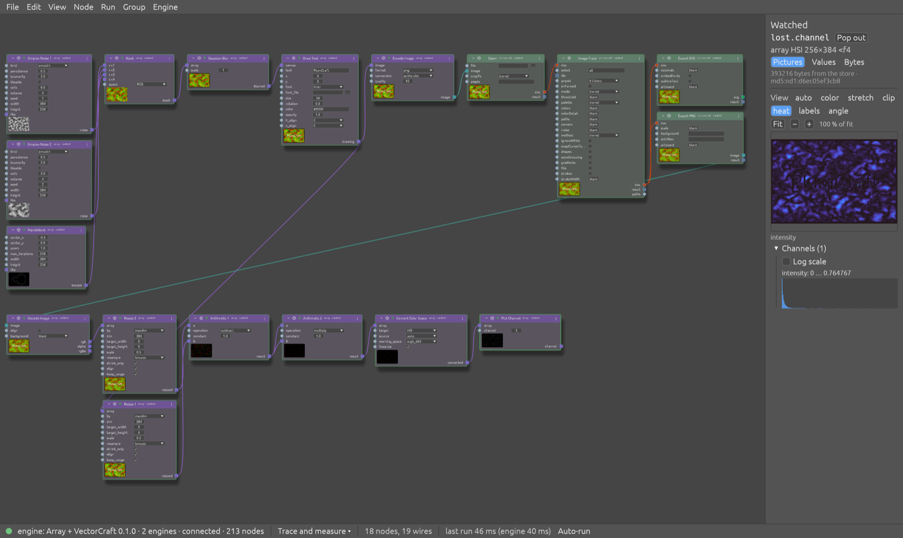

# PlumCraft


PlumCraft is a native node-flow editor whose engines are interchangeable. You wire nodes together on a canvas, and each node runs in whichever engine provides it: compiled in, in a separate process, or on another machine. One graph can use several engines at once.

**Status:** working, pre-release. MIT or Apache-2.0, at your choice (`LICENSE-MIT`, `LICENSE-APACHE`). Bundled fonts and icons keep their own licences, listed in the [guide](docs/guide.md). The plum icon adapts "Santa Rosa Plums" by SummerTomato, CC BY 2.0 (`plums/CREDITS.md`).

## Why PlumCraft exists

PlumCraft grew out of research software supporting [www.virtimp.com](https://www.virtimp.com), which has a native node editor of its own. Most of what makes that editor useful has nothing to do with the research: the canvas, the commands, node status, values shown as they are made. All of that was built around one engine and around pictures.

The craft apps (VectorCraft, GridCraft, SoundCraft and the rest) had the opposite gap. Each is a capable engine with an MCP server, but nothing could chain them. The flow that shows the problem best: take contours from the research software's engine, smooth them in VectorCraft, and carry on with the result back in that engine.

So PlumCraft separates the editor from the engine, with these goals:

- **Any engine, in any language, anywhere.** Every engine speaks one interface, protocol 2 (`docs/interface.md`), and the editor never knows which one it has.
- **Values cross engines unchanged.** Arrays, pictures, audio, tables and the other core types mean the same thing in every engine.
- **Data moves as little as possible.** Values are named by their content, so nothing is uploaded twice and unchanged results are reused. This is how a remote engine stays practical.
- **Nothing is lost.** The research software is the floor: PlumCraft must never support less than it uses, including node status tracking and data in flight.

The name plays on plumbing: piping data between nodes.

## What it does now

- **The editor:** native Rust on egui, with a node canvas, palette, parameter editor, groups, frames, net labels, undo and Tidy. Every action is a command, so tests and agents can drive it over a control channel.
- **Engines:**
  - text, in Rust and in Python;
  - audio, on SoundCraft's crates;
  - array, general array nodes from the research software;
  - 13 craft apps through their MCP servers, each of which needs that app installed.
- **More engines, from GitHub:** each is its own repository, named `plumcraft-<name>-engine`.

  | Engine | Repository | What it does |
  |---|---|---|
  | DuckDB | [plumcraft-duckdb-engine](https://github.com/seantrue/plumcraft-duckdb-engine) | reads data files into tables and reshapes them with SQL |
  | OpenCV | [plumcraft-opencv-engine](https://github.com/seantrue/plumcraft-opencv-engine) | filters, edges, thresholds, morphology and geometry |
  | Atlas | [plumcraft-atlas-engine](https://github.com/seantrue/plumcraft-atlas-engine) | a sample engine with every type, a starting point to copy |

  In the editor, Engine › Install Engine… installs one: it runs `uv tool install` and the engine's `register`, then reloads the Engine menu. From a shell, `uv tool install git+https://github.com/seantrue/plumcraft-duckdb-engine` then `duckdb-engine register` does the same. Both need [uv](https://docs.astral.sh/uv/).
- **Your own engine:** `plumcraft-engine new` generates a standalone Python engine project with tests, a conformance check and PyCharm run configurations. There's no Rust build involved. Publish it as a package or a GitHub repository; `<engine> register` offers it in every editor.
- **Hosting:** any engine runs in-process, as a separate process on a Unix socket, or over HTTP, including on another machine. The AMQP (pipekit) binding is planned, not built.
- **Several engines in one graph:** a coordinator splits each run across the engines and passes values between them. In the picture below, the array engine draws text over noise, VectorCraft traces it, and the array engine measures what the trace lost.
- **Viewers:** every type of value has a preview and a full viewer, from pictures and PDF pages to audio and sortable tables. Any value can pop out into a window that updates on every run, and pictures have a pixel probe and A/B compare.
- **A base for applications:** the editor is a library with registries for engines, value editors and file openers. The research software's own application is built this way in a separate repository, so PlumCraft itself stays free of any engine.



The maintainer has accepted checklists P01–P06. P07–P09 were closed on the maintainer's word after AI runs, and each records what nobody has tried by hand, such as P09's PyCharm debugger (`docs/acceptance/`).

## Roadmap: milestone Q, streaming

Today a run is a batch: finished values go in and finished values come out. A clip of audio has to fit in memory and is capped at 10 minutes at 192 kHz, and a microphone or a growing log has no place in a graph at all.

Milestone Q adds processing in queued chunks, for data that is too long to hold or never ends. It was accepted on 2026-10-27 after two adversarial reviews. **It isn't scheduled and none of it is built.** The estimate is 56–72 working days.

- **Streams on wires:** a wire type can declare that it streams, either samples (audio frames, characters) or whole items (lines, files, frames).
- **Existing nodes keep working:** a stream-aware node keeps state between chunks, and a node that needs its whole input gets it through an automatic accumulate step.
- **Bounded memory:** every edge is a bounded queue. It waits for room, drops the oldest chunk or keeps only the latest, depending on the edge. Deadlocks are detected and resolved, or fail with a named error.
- **Live control:** an editor transport, parameters that change while a stream runs, and live views that can never stall the graph.
- **The same answer as batch:** a stream must match the batch result at every chunk size tested, and an audio chain must match it bit for bit.

| Step | What it delivers | Days |
|---|---|---|
| Q0 | The stream sections of the interface, protocol types and hostile-input tests | 4–5 |
| Q1a | The threaded streaming executor, with Rust text nodes | 9–11 |
| Q1b | Host support in-process and over a socket: panic recovery, stats, taps, timeouts | 8–10 |
| Q2 | The editor: stream typing, badges, transport, live views | 6–8 |
| Q3 | The Python stream SDK; HTTP taps and push | 6–8 |
| Q4a | Offline audio: bit-exact chains and a 2-hour file in bounded memory | 8–10 |
| Q4b | Live audio: microphone, monitoring under 150 ms, meters | 7–9 |
| Q5 | Whole graphs on the cooperative executor, for engines that can't share threads | 3–4 |
| Q6 | An evaluation of dora-rs and pipekit for distributing streams | 5–7 |

**Not in Q:** building distribution itself (Q6 only evaluates it), hard real-time, video, MIDI and per-chunk memo.

The full design is in `docs/plan.md`, section 10.5. `ROADMAP.md` holds asks and ideas not yet in a milestone.

## Find out more

[Installers for macOS and Linux](https://github.com/seantrue/plumcraft/releases/latest) hold the editor, the command line and every engine, audio included: a notarized DMG for Apple silicon, and a `.deb` and a tarball for x86-64 Linux with glibc 2.35 or later, such as Ubuntu 22.04 or Debian 12.

From source:

```sh
cargo install plumcraft-editor    # the editor, from crates.io
cargo install plumcraft           # the command line
pip install plumcraft-engine      # the Python engine SDK, from PyPI
```

The installed editor runs the text and array engines by itself. Crafts need `cargo install plumcraft-craft` and the craft app, and the audio engine builds from a checkout: `cargo build -p plumcraft-audio`.

- [`docs/guide.md`](docs/guide.md): pictures, every way to run it, what's built, the crates, and how to build and test.
- [`docs/STATUS.md`](docs/STATUS.md): where things stand and what's next.
- [`docs/plan.md`](docs/plan.md): the plan, with its architecture, decisions and milestones.
- [`docs/interface.md`](docs/interface.md): the UI ↔ engine interface, protocol 2.
- [`CONTRIBUTING.md`](CONTRIBUTING.md), [`SECURITY.md`](SECURITY.md) and [`CHANGELOG.md`](CHANGELOG.md).
- [`AGENTS.md`](AGENTS.md): rules for contributors and AI agents.
