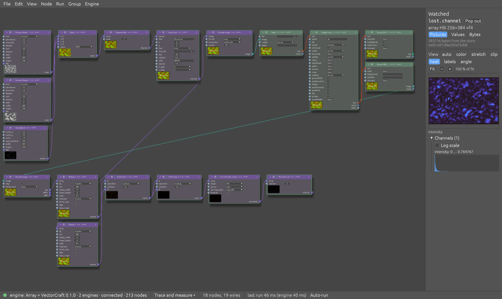
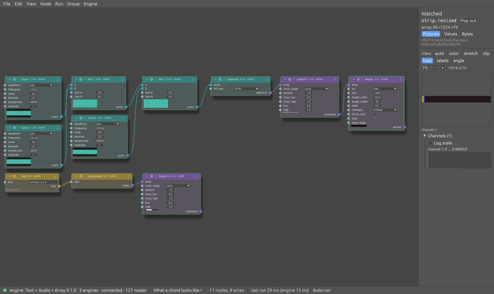
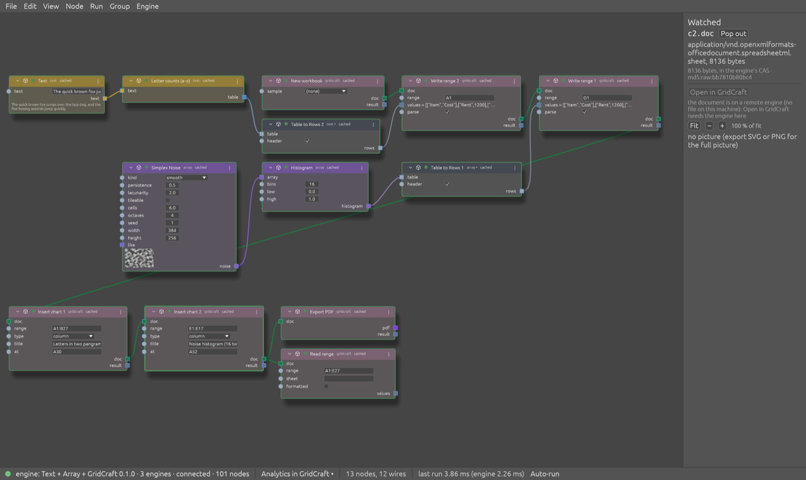
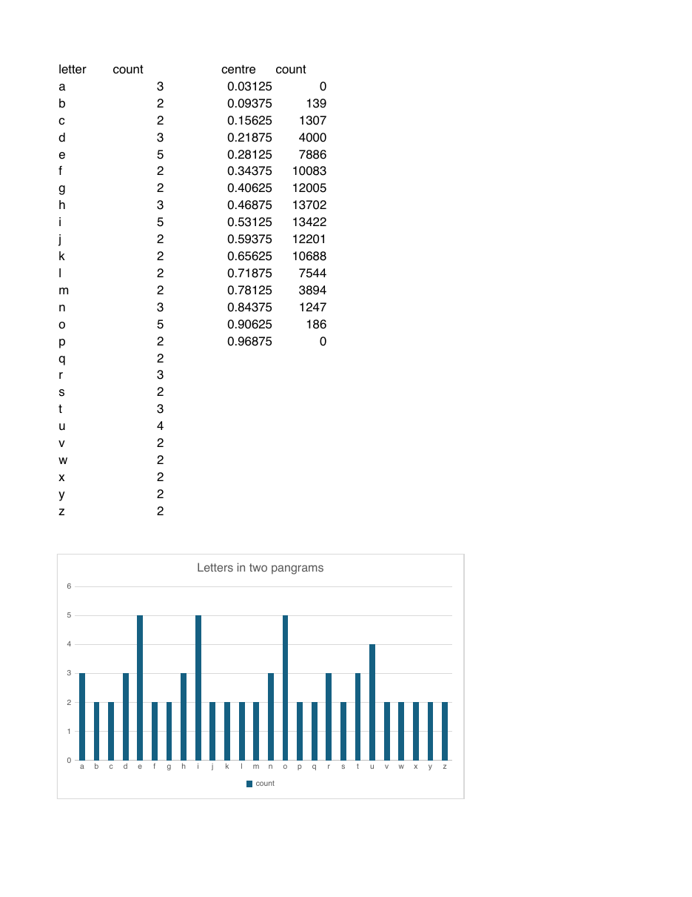
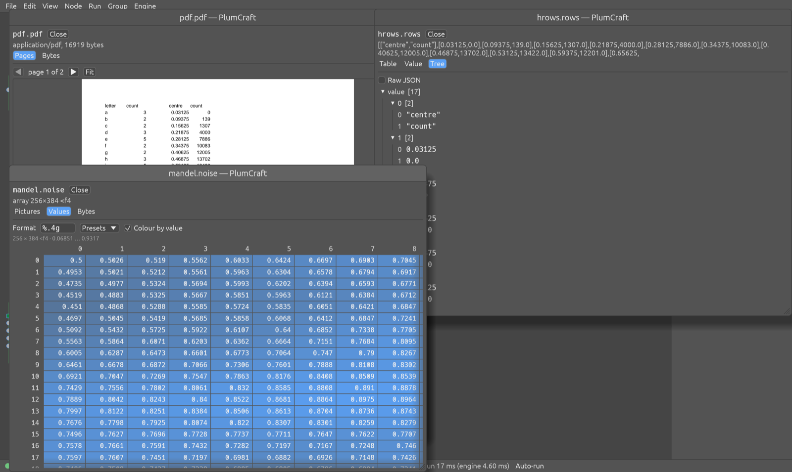
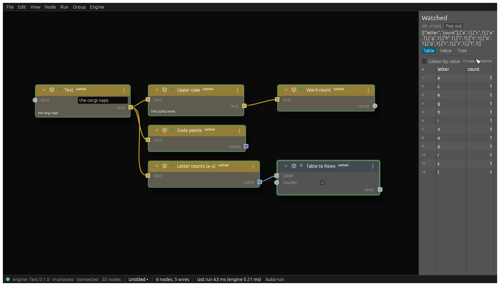
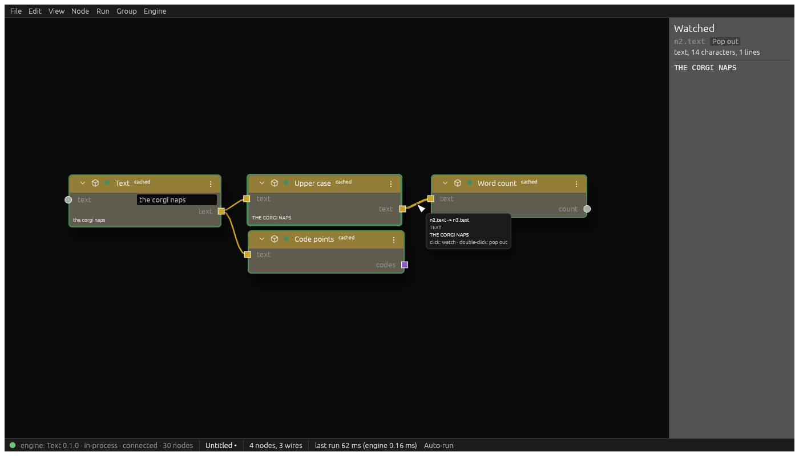
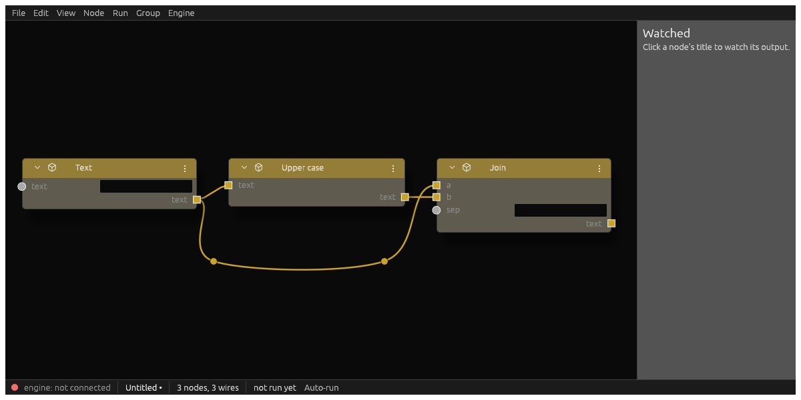

# PlumCraft guide

The detail behind the [README](../README.md): pictures, how to run it, what's built, the crates, and how to build and test. Paths in backticks are from the repository root.

## Status

Working, pre-release; MIT or Apache-2.0, at your choice (`LICENSE-MIT`, `LICENSE-APACHE`; the bundled Inter font and Lucide icons keep their own OFL and ISC licences, in `crates/ui/assets`; the plum icon and art adapt "Santa Rosa Plums" by SummerTomato, CC BY 2.0, credited in `plums/CREDITS.md`).

- **Engines:**
  - text, in Rust and in Python;
  - audio, on SoundCraft's crates;
  - array, general array nodes from research software supporting www.virtimp.com;
  - every artcraft app with an MCP server, through the craft adapter (VectorCraft, GridCraft, PdfCraft, SoundCraft and nine more).
- **Hosting:** every engine runs in-process, as a separate process or over HTTP.
- **How values move:** values cross engines as blobs named by content handle, and unchanged results are reused from the memo.
- **Accepted by the maintainer so far:** P01–P06. P07–P09 were closed on the maintainer's word after AI runs; each says what wasn't tried by hand (`docs/acceptance/`).
- **Planned next:** milestone Q (streaming in queued chunks).

See `docs/STATUS.md`.

## Pictures

### Several engines in one graph

**Trace and measure** (`--engine array,vectorcraft`): the array engine draws "PlumCraft" over noise, VectorCraft's Image Trace vectorises it, and the array engine measures what the trace lost. The Watched panel shows the loss as a heat map.



**What a chord looks like** (`--engine text,audio,array`): the audio engine mixes three tones into A minor and takes its spectrum. The array engine stretches the spectrum into a strip, and the text engine turns the chord's name into code points.



**Analytics in GridCraft** (`--engine text,array,gridcraft`): the text engine counts letters and the array engine takes a histogram of noise. Table to Rows turns each into rows, and GridCraft writes both into a workbook, charts them and exports a PDF.





### Viewers

Every type of value has a preview and a full viewer, and any value can be popped out into a window of its own. Pop-outs aren't modal, and each one updates on every run. Below:

- a PDF's pages;
- rows as a JSON tree;
- an array as a grid of values, like PyCharm's "View as Array".



A craft document that PlumCraft can't show itself (a SoundCraft session, a VectorCraft drawing; PdfCraft's PDFs show as pages) pops out in its own app instead. Edit it there and save. Everything downstream of that output goes stale, saying "edited in SoundCraft", and runs again on your saved version. The node's own value is untouched, and saving the original back (or `doc.revert`) returns to it. Edits last while the graph is open; they aren't saved with the workflow.

Rows and tables show in a table: sortable by a header click, with resizable columns.



### On the canvas

Hovering a wire previews the value on it. A click on a wire watches it, and a double-click pops it out.

A double-click on a node, on its title or a bare part of it, opens Edit Parameters: every input of the node in a window of its own. A double-click in one of its fields stays with the field. A single click on the title still watches the node's output, so a double-click there also watches it.

A socket's label names its type when its name doesn't, such as `audio · WAV` beside an `audio` that is an AUDIO. Two ports with the same name and different types then look different.



Wires can be bent around nodes: right-click › Add Bend Point, then drag.



A wire can also be drawn as a net label, as in a schematic: right-click › Draw as Label… or Label All Uses…. It shows as a name at each end instead of a line, which is how a picture feeding 29 nodes stays readable. What runs doesn't change.

### In the terminal

`plumcraft run` drives an engine and prints the interface as it happens. The built-in demo has a node that always fails, so its downstream node is skipped, and a node that is reused from the memo (`cached`):

```text
$ cargo run -p plumcraft -- run
  0.000s hello    engine Text 0.1.0, protocol 2, session s-43746
                  caps: codec.json data.path data.shm display.stream events.poll events.push events.resume status.progress
  0.001s run      accepted: {"accepted":true,"queued_behind":0,"run_id":"cli-43746-4745308781897886162"}
  0.002s #2    story    started
  0.002s #3    story    preview   thumb "A corgi naps on a floral carpet.\nThe carpet is r"
  0.002s #4    story    done      0.4 ms
  0.002s #5    broken   started
  0.002s #6    broken   error     op: this node always fails
  0.002s #7    after    skipped   skipped: upstream broken did not finish
  …
  0.003s #9    think    cached
  …
  0.003s #17   shout    preview   thumb "A VERY GOOD CORGI NAPS ON A FLORAL CARPET.\nTHE C"  [watched shout.text: text, 70 characters, 2 lines]
  0.003s #18   shout    done      0.0 ms
  0.003s reply    ok=false elapsed 1.7 ms

node      state      ms
story     done           0.4
broken    error          0.5
after     skipped        0.0
think     cached         0.4
swap      done           0.0
count     done           0.0
shout     done           0.0

watched shout.text (Text): text, 70 characters, 2 lines
  | A VERY GOOD CORGI NAPS ON A FLORAL CARPET.
  | THE CARPET IS RED AND GOLD.
```

`plumcraft nodes` lists the catalogue:

```text
$ cargo run -p plumcraft -- nodes
seq.rows_table Rows to Table (rows:ANY, header:BOOL) -> (table:ANY)
seq.table_rows Table to Rows (table:ANY, header:BOOL) -> (rows:ANY)
text.codes     Code points  (text:TEXT) -> (codes:ARRAY)
text.join      Join         (a:TEXT, b:TEXT, sep:STRING) -> (text:TEXT)
text.letters   Letter counts (a–z) (text:TEXT) -> (table:TABLE)
…
```

## Try it

```sh
cargo build
cargo run -p plumcraft-editor                          # the editor on the text engine, in-process
cargo run -p plumcraft-editor -- --python              # the same engine written in Python, as a separate process
cargo build -p plumcraft-audio && cargo run -p plumcraft-editor -- --engine audio     # the audio engine: waveforms, spectrogram, playback
cargo run -p plumcraft-editor -- --engine array        # the array nodes
cargo run -p plumcraft-editor -- --engine vectorcraft  # VectorCraft through the craft adapter (any craft pack by name)
cargo run -p plumcraft-editor -- --engine array,vectorcraft         # several engines: opens Trace and measure
cargo run -p plumcraft-editor -- --engine text,audio,array          # opens What a chord looks like
cargo run -p plumcraft-editor -- --engine text,array,gridcraft      # opens Analytics in GridCraft
cargo run -p plumcraft-editor -- examples/data.json --http --python # over HTTP, as a remote engine: uploads, downloads
cargo run -p plumcraft -- run --watch shout.text   # the interface live in the terminal
cargo run -p plumcraft-editor -- check flow.json     # what's wrong with a workflow, on the engines it names
cargo run -p plumcraft-editor -- run flow.json --out results   # no window: its Result nodes, or else its Write Files nodes
cargo run -p plumcraft-editor -- tidy flow.json      # Edit › Tidy, saved
```

**Write your own engine,** in Python, with no Rust build:

```sh
uv run --project python plumcraft-engine new ~/workspace/weather-engine --name Weather --types text,table,array,svg
cd ~/workspace/weather-engine && uv sync
scripts/check     # ruff, its tests, conformance
scripts/editor    # the editor, which starts the engine from its manifest
```

That is a standalone project with example nodes for each type, tests, a demo, command-line scripts and PyCharm run configurations; `python/README.md` has the details.

- **Engine modes:**
  - none: compiled in;
  - `--process`: a separate process on a Unix socket;
  - `--python`: the Python engine as that process;
  - `--http [--python]`: HTTP, talked to as a remote engine would be.
- **Craft packs:** cadcraft, deckcraft, designcraft, effectcraft, figcraft, filmcraft, gridcraft, pdfcraft, photocraft, solidcraft, soundcraft, vectorcraft and wordcraft. Each needs that app installed.
- **While the editor runs:** pick an engine that isn't connected in the Engine menu to add it; Clear Engines first to replace them all.
- **Engine › Pick Engines Automatically:** a workflow you open or insert starts the engines it names that aren't connected, each hosted the fastest way there is: in-process (mode 1), then a separate process, then HTTP. Each is tried once; one that can't start is said in the status bar, as before. The setting is saved with the editor's preferences.
- **Remote engines:** `plumcraft run --attach http://HOST:PORT` reaches an engine already running elsewhere, with `PLUMCRAFT_ENGINE_TOKEN`.
- **Engines from files:** `--engine-manifest FILE` and `~/.config/plumcraft/engines/*.toml` name engines this build doesn't know (spec 16.6), in the editor and in `plumcraft run`.
- **Control channel:** the editor's `--control PORT` opens it for tests and agents (`docs/control-protocol.md`).

## What's built

| Milestone | What | Checklist |
|---|---|---|
| S, the thin slice | Protocol 2 types and JSON Schema; the engine SDK and executor; in-process and socket hosting with supervision; the text engine; conformance tests | P01 |
| Python, memo | The text engine in Python, byte-identical on the wire to the Rust one; the memo (plan keys over a typed canonical form, shared vectors, `cached` reruns) | P01 |
| D, the data plane | Blobs in commonkit named by handle (`md5:raw:`, `md5:nd1:`), the same-host proof, tables and arrays, file sources keyed by content; HTTP with upload-once and lazy verified download into the UI's own CAS; a run from one machine to another | P02, P03 |
| E, the editor | Lifted from research software supporting www.virtimp.com: graph model, every action a command, egui-snarl canvas, widgets, palette, Watched panel, theme from craft-ui; the control channel; files, undo, copy and paste; groups with collapse, promotion and insert; Tidy; wire bend points | P04 |
| F, audio | `plumcraft-audio` on SoundCraft's crates, an optional engine the editor starts as a process: 46 nodes; audio values with waveform peaks; spectrogram and playback in the editor | P05 |
| Convert (`docs/research/20-convert.md`) | A refused wire offers the converters that bridge it ("Insert WAV to Audio", `wire.convert`); the Convert node takes its types from its wires, keeps its path, and runs as its converters | — |
| Install Engine… | Engine › Install Engine… (`engine.install`): a Python engine from GitHub, by `uv tool install` and its `register`, in the background; the window offers the public engines | — |
| The Engine menu | Switch engine and hosting while the editor runs, keeping the graph; Reconnect; Attach. The commands come first, Clear Engines among them; each engine is a submenu of its connections, in a list that scrolls in a short window. A pick adds that engine, or changes its connection when it is connected | P06 |
| M, craft engines | The craft MCP adapter: any artcraft app's MCP server as nodes, from a manifest; VectorCraft first, then every craft with a server | P07, P08 |
| Several engines | The coordinator: one graph across several engines, each run split into per-engine fragments joined by bindings; three demos | — |
| Viewers | A viewer registry with a preview and a full view for every type (picture, SVG, PDF pages, array pictures and values, table, text, JSON tree, list items, audio, hex); pop-out windows; values on wires | — |
| Engine generator | `plumcraft-engine new`: a standalone Python engine project, scripts and PyCharm files; `check` conformance; engines from manifests | P09 |

## Read first

| File | What |
|---|---|
| `docs/STATUS.md` | Where things stand and what's next |
| `docs/plan.md` | The plan: architecture, decisions D1–D39, milestones |
| `docs/interface.md` | The UI ↔ engine interface, protocol 2 |
| `docs/control-protocol.md` | The editor's control channel |
| `ROADMAP.md` | Asks and ideas not yet in a milestone |
| `docs/research/` | The research behind the plan: 02–08 (transports, the data plane, visualisation, artcraft MCP engines, hosting modes, the name, the first review); 09–13 (the streaming plan, two adversarial reviews and two revisions); 14 (the craft MCP adapter); 15 (several engines); 16 (viewers); 17 (the engine generator) |
| `docs/acceptance/` | The maintainer's checklists and results |
| `AGENTS.md` | Rules for contributors and AI agents |
| `AI.md` | What AI helpers contributed, and what they got wrong |

## Crates

| Crate | Layer | What |
|---|---|---|
| `plumcraft-proto` | L0 | Protocol 2 types: handles, data references, sessions, the catalogue, runs, events, displays, errors, memo keys, and the status reducer. No engine, no I/O |
| `plumcraft-engine` | L1 | The Rust engine SDK (`Node`, `Cx`, `Engine`, typed values `Data`: JSON, arrays, audio), the executor with the memo and data plane, the in-process host, and the socket and HTTP fronts |
| `plumcraft-store` | L1 | Blobs in the commonkit store (key layout, `.npy` write and read, handle-checked resolve), and the same-host proof's nonce files |
| `plumcraft-layout` | L0 | Tidy: the layered node layout behind Edit › Tidy (`graph.tidy`): left to right, packed to the top, parameters in a lane beside the pins they feed, long chains wrapped where the fewest wires cross (lifted from research software supporting www.virtimp.com) |
| `plumcraft-array` | L3 | The array engine (`--engine array`): general array nodes from research software supporting www.virtimp.com (51: files and channels, colour, maths, filters and edges, geometry, generators, regions, drawing and text, FFT; craft-fonts for Draw Text when built with `CRAFT_FONTS_DIR`) on the CPU, ported from yapocis's numba kernels with npexact for numpy's own numerics |
| `plumcraft-graph` | L1 | The graph model: nodes, widget values, typed wires checked against the catalogue, wire bend points, net labels, groups, workflow JSON (lifted from research software supporting www.virtimp.com) |
| `plumcraft-host` | L2 | The UI side of every binding behind one `Connection`: in-process, a supervised process on a Unix socket, and HTTP (spawned or attached, uploads and verified downloads) |
| `plumcraft-coordinator` | L2 | One engine made of several (`docs/research/15-multi-engine.md`): a `Connection` over sub-engine connections. With one it passes everything through; with several it answers the merged catalogue and splits each run into per-engine fragments joined by bindings. The editor uses it when the Engine menu adds a second engine |
| `plumcraft-session` | L3 | The editor session: every action a command; graph, group, file, edit, run and view commands; undo; run state over the proto reducer, with watch roles for the panel, pop-outs and peeks (lifted from research software supporting www.virtimp.com) |
| `plumcraft-ui` | L4 | The egui editor: node canvas (egui-snarl), widgets, palette, groups, wire bends, net labels, the Watched panel, the viewer registry and pop-out windows (`viewers/`, `popouts.rs`), values on wires, theme from craft-ui, control handlers, offscreen rendering (lifted from research software supporting www.virtimp.com) |
| `plumcraft-automation` | L4 | The control channel: loopback TCP with a token |
| `plumcraft-svg` | L0 | SVG, a core type like ARRAY: parse (bounded, no external files) and rasterise with resvg, text with the system's fonts; the editor's SVG view and the engine SDK's SVG thumbnails share it |
| `plumcraft-scratch` | test | One scratch directory per test process, swept once that process has exited |
| `plumcraft-editor` | app | The editor: any engine or several (`--engine text\|audio\|array\|<craft>`, comma-separated), any mode, `--control`; the demos in `apps/plumcraft-editor/demos/` |
| `plumcraft` | app | `plumcraft run` / `plumcraft nodes`: drive an engine and print the interface live |
| `plumcraft-view` | app | The first minimal window (retires now the editor covers it) |
| `plumcraft-conform` | test | The generic conformance cases (spec 19): any engine, any binding, graphs from its catalogue. `plumcraft conform --engine-manifest FILE` runs them, and the text engine's suite calls them |
| `plumcraft-text` | example | The thin text engine the interface is proven on (`plumcraft-text-engine` serves modes 2 and 3), with the conformance suite every mode runs |
| `plumcraft-audio` | example | The audio engine on SoundCraft's DSP and file I/O: load, save, generators, edits, SoundCraft's effects as nodes, analysis; `plumcraft-audio-engine` serves modes 2 and 3 |
| `plumcraft-craft` | engine | The craft MCP adapter: an artcraft app's MCP server as nodes, generic over a manifest (MCP client, process pool, craft CAS, selection, memo salt); a pack per craft, VectorCraft's curated (25 nodes, 119 effects, `vc.run`); `plumcraft-craft-engine --craft NAME` serves modes 2 and 3 |
| `python/` | example | The engine SDK in Python (`plumcraft_engine`: an engine is a class with typed `@node` methods, see `python/README.md`) and the text engine written with it (`plumcraft_text`) |

## Build and test

```sh
cargo test --all-features
cargo clippy --all-targets --all-features -- -D warnings
cargo fmt --all --check
(cd python && uv run pytest && uv run ruff check .)
```

**Requirements:**

- Rust (stable).
- `uv`: the Python engine and its tests run under `uv run`, or `$PLUMCRAFT_UV`.
- Network access on first build:
  - crates.io and PyPI dependencies: commonkit is the `commonkit` crate and the `pyuncommonkit` package;
  - git-pinned dependencies: craft-ui from `storytold/craft-libs`, and SoundCraft's crates from `storytold/soundcraft`.
- Craft engines need the craft app installed. Tests that need one skip without it.

**On Windows** (x86-64, MSVC toolchain), PlumCraft builds from a checkout, with no installer yet:

- Clone with real symlinks: `git clone -c core.symlinks=true https://github.com/seantrue/plumcraft.git`. Some crates share `digest.rs` and the licence files through links, and Git for Windows writes a link as a one-line text file unless symlinks are on. That needs Developer Mode, or an elevated shell.
- `.gitattributes` keeps text files LF whatever `core.autocrlf` says, since tests compare bytes with checked-in files.
- Process engines connect over loopback TCP, not a Unix socket (`docs/interface.md`, section 16.3, which also says what that trusts).
- `pyuncommonkit` 0.1.0 has no Windows store root, and its fallback (`\dev\shm\commonkit` on the current drive) isn't the Rust side's (`%LOCALAPPDATA%\commonkit\store`). Set `COMMONKIT_STORE_ROOT` until a release has commonkit's fix.

Engines in other languages can check their messages against `crates/proto/schema/protocol2.json` (JSON Schema 2020-12).
